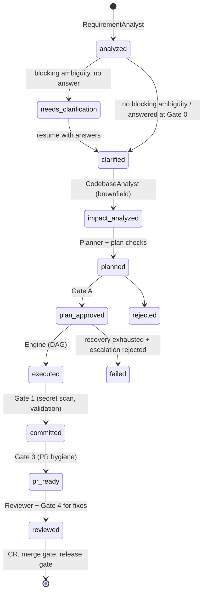

# Architecture

## Goals and principles
1. **LLMs for judgment, code for everything else.** Agents interpret, plan, design, write and review.
   Running tests, scanning, git, versioning and rendering reports are deterministic tools, so every number
   in a report is real.
2. **Typed contracts at every boundary.** Each agent returns a pydantic model (`orchestrator/models.py`).
   Invalid output is caught where it enters, repaired once or twice, or the task fails cleanly.
3. **Controlled autonomy.** Agents run freely *between* gates; humans (or a written policy) decide *at*
   gates. Blockers can never be auto-approved.
4. **Provider-neutral.** One method (`LLMProvider.complete`) separates the system from any model vendor.
5. **Resumable and auditable.** State is checkpointed after every task; every event and gate decision is
   logged as JSONL.

## Components

| Component | File | Responsibility |
|---|---|---|
| CLI | `cli.py` | `implement`, `resume`, `review`, `cr`, `release`, `validate`, `demo` |
| Workflow | `workflow.py` | Phase state machine per run; builds agent context; commit/PR/review/CR/release |
| Engine | `orchestrator/engine.py` | Executes the task DAG: parallelism, file ownership, retries, failure routing, escalation |
| Task graph | `orchestrator/dag.py` | Validation (cycles, unknown deps), levels, ready set, ancestors |
| Gates | `orchestrator/gates.py` | `InteractiveApprover` (terminal) and `PolicyApprover` (YAML policy + answers file) |
| Events | `orchestrator/events.py` | JSONL run log + console |
| Agents | `agents/roles.py`, `prompts/*.md` | RequirementAnalyst, CodebaseAnalyst, Planner, Architect, Coder, Tester, DocWriter, Reviewer |
| LLM layer | `llm/` | Structured calls with budget, backoff, repair; mock/recording/Anthropic/OpenAI-compatible providers |
| Tools | `tools/` | Sandboxed workspace, git, pytest runner, static checks, contract check, secret scan, ast code index, review checks, GitHub |
| Config | `config.py` | Every setting as an environment variable (process, then Windows user scope, then default); validation; secrets never shown |
| Observability | `observability.py`, `diagnostics.py` | Redacted per-run debug log, LLM transcripts (`--debug`), alerts to file and webhook, `sdlc debug` / `logs` / `alerts` |
| Reports | `reports.py` | Plan, PR body (fills `standards/pr_template.md`), review, engineering summary, CR, release notes |

### Agents

| Agent | Input | Output |
|---|---|---|
| RequirementAnalyst | raw requirement (+ answers when refining) | `RequirementSpec`: kind, intent, acceptance criteria, NFRs, ambiguities (blocking/minor + default) |
| CodebaseAnalyst | spec + ast index + source | `ImpactAnalysis`: architecture, impacted files with risk, data flows, test gaps |
| Planner | spec + impact + standards | `Plan`: task DAG with owner agent, dependencies and outputs; change size; risks; trade-offs |
| Architect / Coder / Tester / DocWriter | task + upstream files + feedback | `TaskOutput`: file changes, notes, decisions |
| Reviewer | spec, standards, PR, diff, static findings | `ReviewResult`: verdict, per-criterion coverage, findings, missed scenarios, proposed fixes |

The validator is not an LLM. It is a task in the graph that runs the deterministic checks.

## Control flow



### Inside the engine
```
loop:
  ready = tasks whose dependencies are all done   (not running, not failed/skipped)
  submit each ready task to the thread pool       → independent tasks run concurrently
  wait for the first to finish
    producer task: agent → TaskOutput → guardrails → write files (records file owner)
       exception → retry with the error as feedback (max_attempts) → else FAILED, dependents SKIPPED
    validator task: run checks
       pass → DONE
       fail → route_failure() → re-run owning task(s) with the check output as feedback → validate again
            → owners exhausted → Escalation gate: human note becomes guidance for one more attempt, or fail
  checkpoint state.json
```

**Cross-step coordination, not just sequencing:**
- *Shared state by contract:* the architect's OpenAPI file is the input of the coder and the tester, who
  work in parallel; the contract check then holds the implementation to it.
- *File ownership:* each file records the task that wrote it. A task may only overwrite files owned by its
  ancestors, so parallel tasks cannot race on a file (enforced at runtime, and checked statically in the plan).
- *Failure routing:* `Engine.route_failure` reads the failing check's output and finds the responsible task:
  application files named in a traceback or lint → their owner; an assertion failing inside a test → the
  modules that test imports → their owner; a test that cannot be collected → the tester; a contract
  mismatch → owners of route-declaring files. Only that task is re-run, with the failure as feedback.
  In the URL shortener scenario, a SQLite/PostgreSQL type mismatch in `app/analytics.py` surfaces as a
  failing integration test; the engine re-runs the coder task T3 (not the tester) and validation passes.

### Plan checks (before any code is written)
No cycles or unknown dependencies; exactly one validator, depending on every producing task; tasks in the
same parallel level must not declare the same output file.

## Guardrails

The full threat model and control mapping is in [security.md](security.md).

| Risk | Guardrail |
|---|---|
| Agent writes outside the repo, or into `.git`, CI workflows, run state | `Workspace.resolve` rejects absolute paths, `..`, drive letters and protected prefixes |
| Huge or runaway output | per-file byte limit, per-task file limit, LLM call budget per run, subprocess timeouts |
| Malformed model output | schema validation + repair prompt; transient errors get exponential backoff |
| Secrets committed | regex + entropy scan on every commit gate (blocker); findings show file/line/rule, never the value |
| Unsafe generated code | `eval/exec`, `os.system`, `shell=True`, `pickle.loads`, unsafe `yaml.load`, `verify=False`, f-string SQL |
| Code drifts from the API | contract check: operations in `openapi.yaml` == operations served by the app (run in a subprocess) |
| Generated code harms the orchestrator | generated code only ever runs in subprocesses, never imported in-process |
| Generated code steals credentials or calls out | allowlisted subprocess environment (no keys/tokens) + loopback-only network guard |
| Prompt injection via repository content | content fenced as untrusted in every prompt; tripwire scan surfaced at the plan gate |
| Vulnerable code or dependencies | Bandit on application code; pip-audit on declared dependencies |
| Audit trail edited afterwards | hash-chained event log, head anchored in every commit message, `sdlc audit` |
| Work lands on `main` | git wrapper refuses to commit to `main`/`master` (except the initial bootstrap) |
| Tests weakened to pass | coder prompt forbids it; failures are routed to the code owner, not the tester, unless the test itself is broken |
| Unattended run goes too far | default-deny policy; escalation is rejected in `auto.yaml`; `strict.yaml` stops before commit |
| Credentials leaking via git | GitHub token sent as a per-command header; never in config, remote URL or logs |

## Key design decisions and trade-offs

| Decision | Why | Trade-off |
|---|---|---|
| Explicit DAG from the planner, executed by code | Dependencies are inspectable, approvable (Gate A) and validated before execution | Less flexible than a free-form agent loop; re-planning mid-run is limited to retries/escalation |
| Agents return whole files, not patches | Simple and robust to apply; easy to validate | Larger outputs for big files; a production version would add patch output for large brownfield files |
| Deterministic validation as the source of truth | An LLM reviewer can be wrong; tests and checks cannot be talked into passing | Quality is bounded by test quality, so the reviewer also checks coverage per acceptance criterion |
| Mock replay provider as the default | Reviewers can run everything offline and deterministically | Replayed answers are fixed; live runs vary (recorded with `--record`) |
| Thread pool for parallelism | LLM calls are I/O-bound; simple and portable | Not distributed; a queue + workers would be the next step for many concurrent runs |
| Local git + markdown PR/CR, optional GitHub | Works on any machine; nothing is pushed without a token | Local PR review is a file, not a GitHub conversation |
| One validator task at the end | One place for checks and routing | Earlier per-module validation would fail faster on large plans |
