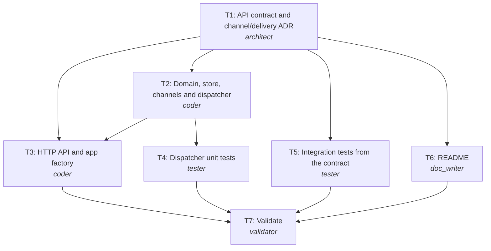

# Plan: REQ-303 In-app order notifications with user preferences

**Rationale:** The clarified answers fix the scope (three order events, in-app only, 2 s target), so a synchronous design with a channel abstraction is enough. Contract first (T1). Domain + dispatcher (T2), integration tests from the contract (T5) and docs (T6) then run in parallel; the HTTP layer (T3) and dispatcher unit tests (T4) follow T2.

**Change size:** minor (New service; no existing consumers.)

## Tasks
| Task | Agent | Title | Depends on | Outputs |
|---|---|---|---|---|
| T1 | architect | API contract and channel/delivery ADR | - | api/openapi.yaml, docs/adr/0001-channels-and-delivery.md |
| T2 | coder | Domain, store, channels and dispatcher | T1 | pyproject.toml, notify/__init__.py, notify/models.py, notify/store.py, notify/channels.py, notify/dispatcher.py |
| T5 | tester | Integration tests from the contract | T1 | tests/test_api.py |
| T6 | doc_writer | README | T1 | README.md |
| T3 | coder | HTTP API and app factory | T1, T2 | notify/api.py, notify/main.py |
| T4 | tester | Dispatcher unit tests | T2 | tests/test_dispatcher.py |
| T7 | validator | Validate | T3, T4, T5, T6 | - |

## Execution order (tasks on one level run in parallel)
1. T1
2. T2, T5, T6 *(parallel)*
3. T3, T4 *(parallel)*
4. T7

## Risks
- In-memory state is lost on restart and limits the service to one instance; acceptable for v1, replaced by a database-backed store.
- Synchronous fan-out is fine for in-app delivery; adding email without a queue would put provider latency on the ingest path.
- The 2 s p95 target is met by design but not load tested in this run.

## Trade-offs
- Synchronous delivery now vs queue + workers: simpler and well within 2 s for in-app; the queue arrives with email.
- At-least-once with idempotent claims vs exactly-once: much simpler, duplicates are prevented per event_id.
