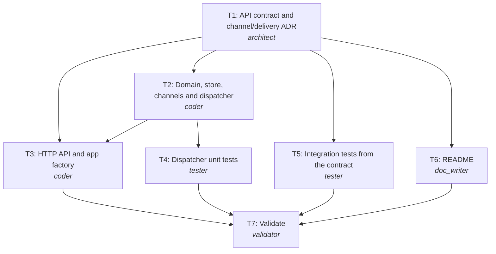

# Engineering summary: REQ-303 In-app order notifications with user preferences

| Field | Value |
|---|---|
| Run | `20261025-225153-a73ad3` |
| Scenario | notifications |
| Provider | mock |
| Phase | reviewed |
| Branch | `REQ-303-user-notifications` |
| Commit | `f6e1c41a3a` |
| LLM calls | 10 |

## 1. Requirement (normalized)
**Kind:** greenfield
**Intent:** Customers see order updates in their in-app inbox within seconds and can switch off the ones they don't want.

Build a notification service that ingests order lifecycle events (order_shipped, order_delivered, order_cancelled) from the order system, idempotently by event_id, and delivers a notification to the user's in-app inbox unless the user has opted out of that event type. Users list their notifications (optionally unread only), mark them read, and manage per-channel, per-event-type preferences. Delivery goes through a channel abstraction so email can be added next quarter without API changes.

**Acceptance criteria**
- AC1: POST /api/v1/events accepts order_shipped, order_delivered and order_cancelled events and returns 202 with the channels delivered to; other types return 422.
- AC2: The same event_id is processed at most once per successful delivery (duplicates return duplicate=true and create nothing).
- AC3: GET /api/v1/users/{user_id}/notifications lists the user's notifications newest first, with ?unread=true filtering; users never see others' notifications.
- AC4: POST /api/v1/users/{user_id}/notifications/{id}/read marks one read; 404 for unknown ids or another user's notification.
- AC5: GET/PUT /api/v1/users/{user_id}/preferences read and change per-event-type opt-ins for in_app (default all on; partial updates keep other values); opted-out events are not delivered.
- AC6: A failing channel does not block other channels; if all fail the API returns 503 and the event can be retried.
- AC7: A notification is in the inbox within 2 s p95 of ingestion (synchronous in-app delivery).

**Non-functional**
- Latency: visible in the inbox within 2 s p95 of the event
- Channel abstraction: adding email must not change the API
- Idempotent ingestion

**Out of scope**
- Email, SMS and push delivery (next quarter)
- Authentication (internal service behind the gateway)
- Persistent storage (v1 is single-instance, in memory)

## 2. Ambiguities and how they were resolved
| Id | Severity | Question | Resolution |
|---|---|---|---|
| Q4 | minor | How fine-grained is control: global mute, per event type, per channel? | Per channel, per event type; everything on by default. |
| Q5 | minor | Can the producer send the same event twice? | Yes; ingestion is idempotent by event_id. |

**Assumptions**
- Q1 answered: order_shipped, order_delivered, order_cancelled from the order system
- Q2 answered: in-app only for v1; email next quarter without API change
- Q3 answered: visible within 2 s p95
- Q4 default accepted: per channel, per event type, all on by default
- Q5 default accepted: idempotent by event_id

## 3. Implementation plan and rationale
**Rationale:** The clarified answers fix the scope (three order events, in-app only, 2 s target), so a synchronous design with a channel abstraction is enough. Contract first (T1). Domain + dispatcher (T2), integration tests from the contract (T5) and docs (T6) then run in parallel; the HTTP layer (T3) and dispatcher unit tests (T4) follow T2.

**Change size:** minor (New service; no existing consumers.)

### Tasks
| Task | Agent | Title | Depends on | Outputs |
|---|---|---|---|---|
| T1 | architect | API contract and channel/delivery ADR | - | api/openapi.yaml, docs/adr/0001-channels-and-delivery.md |
| T2 | coder | Domain, store, channels and dispatcher | T1 | pyproject.toml, notify/__init__.py, notify/models.py, notify/store.py, notify/channels.py, notify/dispatcher.py |
| T5 | tester | Integration tests from the contract | T1 | tests/test_api.py |
| T6 | doc_writer | README | T1 | README.md |
| T3 | coder | HTTP API and app factory | T1, T2 | notify/api.py, notify/main.py |
| T4 | tester | Dispatcher unit tests | T2 | tests/test_dispatcher.py |
| T7 | validator | Validate | T3, T4, T5, T6 | - |

### Execution order (tasks on one level run in parallel)
1. T1
2. T2, T5, T6 *(parallel)*
3. T3, T4 *(parallel)*
4. T7

## 4. Orchestration timeline
| Task | Agent | Attempt | Start | Duration | Overlapped with | Why |
|---|---|---|---|---|---|---|
| T1 | architect | 1 | +0.00s | 0.03s | - |  |
| T2 | coder | 1 | +0.03s | 0.08s | T5, T6 |  |
| T5 | tester | 1 | +0.03s | 0.03s | T2, T6 |  |
| T6 | doc_writer | 1 | +0.04s | 0.07s | T2, T5 |  |
| T3 | coder | 1 | +0.11s | 0.07s | T4 |  |
| T4 | tester | 1 | +0.11s | 0.06s | T3 |  |
| T7 | validator | 1 | +0.19s | 7.05s | - |  |

*Durations are short with the offline provider (no model latency); with a live model each agent step takes seconds to minutes and the parallel levels save that time.*

**Recovery events**
- none

## 5. Generated artifacts
| File | Produced by |
|---|---|
| `README.md` | T6 |
| `api/openapi.yaml` | T1 |
| `docs/adr/0001-channels-and-delivery.md` | T1 |
| `notify/__init__.py` | T2 |
| `notify/api.py` | T3 |
| `notify/channels.py` | T2 |
| `notify/dispatcher.py` | T2 |
| `notify/main.py` | T3 |
| `notify/models.py` | T2 |
| `notify/store.py` | T2 |
| `pyproject.toml` | T2 |
| `tests/test_api.py` | T5 |
| `tests/test_dispatcher.py` | T4 |

## 6. Validation
| Check | Result | Summary |
|---|---|---|
| syntax | ✅ Passed | all Python files compile |
| lint | ✅ Passed | ruff: no issues |
| unsafe-code | ✅ Passed | no unsafe patterns |
| security | ✅ Passed | bandit: no medium/high issues |
| dependencies | ⏭️ Skipped | set SDLC_DEPENDENCY_AUDIT=1 to audit |
| contract | ✅ Passed | 6 operations match api/openapi.yaml |
| tests | ✅ Passed | 15 passed |
| secrets | ✅ Passed | no secrets found |

## 7. Review
**Verdict:** approve_with_comments. The clarified scope is implemented as specified; the channel abstraction keeps the API stable for email. One acceptance criterion (AC7, latency) is met by design but has no automated evidence, so it is marked partial.

- [medium] story coverage: AC7 (2 s p95) has no automated evidence.
- [low] missed scenario: Claimed event ids grow without bound in memory.

## 8. Risks and trade-offs
**Risks**
- In-memory state is lost on restart and limits the service to one instance; acceptable for v1, replaced by a database-backed store.
- Synchronous fan-out is fine for in-app delivery; adding email without a queue would put provider latency on the ingest path.
- The 2 s p95 target is met by design but not load tested in this run.

**Trade-offs**
- Synchronous delivery now vs queue + workers: simpler and well within 2 s for in-app; the queue arrives with email.
- At-least-once with idempotent claims vs exactly-once: much simpler, duplicates are prevented per event_id.

## 9. Human oversight (gate audit log)
| Gate | Decision | By | When | Note |
|---|---|---|---|---|
| clarify | rejected | policy:answers_or_stop | 2026-10-25 22:52:15 | needs a human answer for: Q1, Q2, Q3 |
| clarify | approved | policy:answers_file | 2026-10-25 22:52:16 |  |
| plan | approved | policy:approve | 2026-10-25 22:52:16 |  |
| commit | approved | policy:approve | 2026-10-25 22:52:24 |  |
| pr | approved | policy:approve | 2026-10-25 22:52:42 |  |

Approvals here were given by the written gate policy (`--policy auto`, used for this unattended run). Interactively, a human answers each gate; blockers are never auto-approved.

## 10. Assumptions and limitations
- Q1 answered: order_shipped, order_delivered, order_cancelled from the order system
- Q2 answered: in-app only for v1; email next quarter without API change
- Q3 answered: visible within 2 s p95
- Q4 default accepted: per channel, per event type, all on by default
- Q5 default accepted: idempotent by event_id
- Generated code is validated by tests, lint, an unsafe-pattern scan, a contract check and a secret scan; it is not load tested here. Scalability claims are design-level.
- With the mock provider the agents' answers are pre-written fixtures, not live model output; the orchestration, gates, git operations and all validation run for real.
