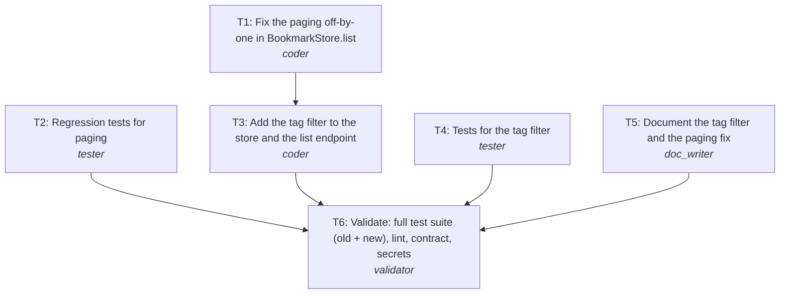

# Plan: REQ-202 Fix bookmark paging and add tag filter

**Rationale:** Fix the bug first and separately (T1) so the fix is small and reviewable on its own, then build the filter on top of the corrected method (T3 depends on T1 because both change bookmarks/store.py). Tests and docs are written from the spec and the impact analysis, so they run in parallel with the code (T2, T4, T5). The validator (T6) runs the full suite, including the existing tests, to prove backward compatibility.

**Change size:** minor (Adds a backward-compatible query parameter; the paging fix restores documented behaviour.)

## Tasks
| Task | Agent | Title | Depends on | Outputs |
|---|---|---|---|---|
| T1 | coder | Fix the paging off-by-one in BookmarkStore.list | - | bookmarks/store.py |
| T2 | tester | Regression tests for paging | - | tests/test_pagination.py |
| T4 | tester | Tests for the tag filter | - | tests/test_tag_filter.py |
| T5 | doc_writer | Document the tag filter and the paging fix | - | docs/api.md |
| T3 | coder | Add the tag filter to the store and the list endpoint | T1 | bookmarks/store.py, bookmarks/api.py |
| T6 | validator | Validate: full test suite (old + new), lint, contract, secrets | T2, T3, T4, T5 | - |

## Execution order (tasks on one level run in parallel)
1. T1, T2, T4, T5 *(parallel)*
2. T3
3. T6

## Risks
- Clients that compensated for the missing item per page will now see one more item per page (correct behaviour, noted in docs changelog).
- Linear tag filtering over the in-memory store; acceptable at current size, needs an index with a database.

## Trade-offs
- Two coder tasks (fix, then feature) instead of one: slightly more orchestration, much easier review and revert of the bug fix alone.
- Exact case-insensitive tag match instead of substring search: predictable and indexable, less fuzzy.
