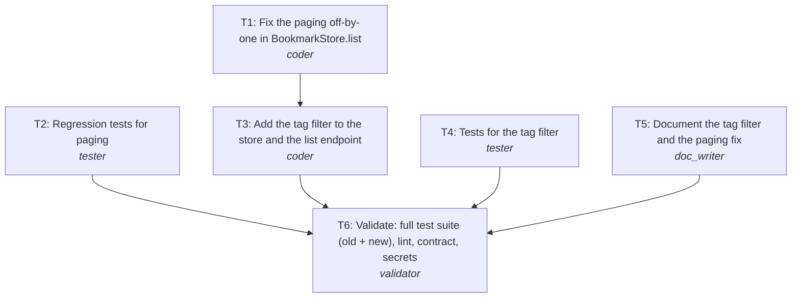

# Engineering summary: REQ-202 Fix bookmark paging and add tag filter

| Field | Value |
|---|---|
| Run | `20261025-225054-c09277` |
| Scenario | bookmarks |
| Provider | mock |
| Phase | reviewed |
| Branch | `REQ-202-fix-bookmark-paging-and-add-tag-filter` |
| Commit | `3778d8a790` |
| LLM calls | 9 |

## 1. Requirement (normalized)
**Kind:** brownfield
**Intent:** Users can page through all of their bookmarks and narrow the list to one tag.

GET /bookmarks drops items when paging: the reported symptom (45 bookmarks do not add up across pages) points to an off-by-one in the page window. Fix it so pages are contiguous and complete, and add an optional, case-insensitive tag filter applied before paging, without changing the response for existing clients that do not send a tag.

**Acceptance criteria**
- AC1: Paging through GET /bookmarks returns every bookmark exactly once; a full page has exactly `size` items.
- AC2: GET /bookmarks?tag=<t> returns only bookmarks having tag t, matched case-insensitively and exactly (not substring).
- AC3: With a tag filter, `total` counts matching bookmarks and paging applies to the filtered list.
- AC4: Requests without `tag` behave exactly as before (backward compatible); invalid paging values still return 422.
- AC5: Regression tests cover the paging bug; docs/api.md documents the tag filter.

**Non-functional**
- No breaking change to the response shape
- Filtering cost is linear in stored bookmarks (in-memory store)

**Out of scope**
- Multiple tags per query
- Persistent storage
- Tag normalisation on write

## 2. Ambiguities and how they were resolved
| Id | Severity | Question | Resolution |
|---|---|---|---|
| Q1 | minor | Should `?tag=py` match `python` (substring) or only `py`? | Exact match, case-insensitive. |
| Q2 | minor | Should multiple tags (`?tag=a&tag=b`) be supported? | Single tag only for now; out of scope. |

**Assumptions**
- Q1: Exact match, case-insensitive.
- Q2: Single tag only for now; out of scope.

## 3. Codebase impact (brownfield)
The paging bug is in BookmarkStore.list: the slice end is `start + size - 1`, so every page returns size-1 items and the last bookmark of each page window is never returned (45 bookmarks with size 20 show 19 + 19 + 5 = 43). The tag filter belongs in the same method, before slicing, with a new optional query parameter in api.list_bookmarks.

**Architecture today:** bookmarks.main:create_app builds the FastAPI app and puts one BookmarkStore on app.state. bookmarks/api.py routes (prefix /bookmarks) call the store and wrap results in pydantic models from bookmarks/models.py (Page = items + total + page + size). BookmarkStore is an in-memory dict guarded by a lock; list() sorts newest first, then slices.

| Path | Kind | Change | Risk |
|---|---|---|---|
| `bookmarks/store.py` | module | Fix slice end to start + size; add optional tag filter (casefold, exact) applied before slicing; total = filtered count. | medium |
| `bookmarks/api.py` | api | Add optional `tag` query parameter (1-50 chars) to GET /bookmarks and pass it to the store. | low |
| `tests/test_pagination.py` | test | New regression tests: pages add up to total, full pages have `size` items, ordering across pages, page past the end. | low |
| `tests/test_tag_filter.py` | test | New tests for the tag filter, case-insensitivity, exact match, paging over filtered results. | low |
| `docs/api.md` | doc | Document `tag`, the meaning of `total`, and the paging fix in a changelog entry. | low |

**Data flows**
- GET /bookmarks?page&size[&tag] -> api.list_bookmarks -> BookmarkStore.list(page, size, tag) -> sort newest first -> filter by tag -> slice -> Page

**Test gaps found**
- tests/test_api.py only checks page 1 with one bookmark, so the off-by-one was never exercised.
- No test covers page/size validation bounds.

## 4. Implementation plan and rationale
**Rationale:** Fix the bug first and separately (T1) so the fix is small and reviewable on its own, then build the filter on top of the corrected method (T3 depends on T1 because both change bookmarks/store.py). Tests and docs are written from the spec and the impact analysis, so they run in parallel with the code (T2, T4, T5). The validator (T6) runs the full suite, including the existing tests, to prove backward compatibility.

**Change size:** minor (Adds a backward-compatible query parameter; the paging fix restores documented behaviour.)

### Tasks
| Task | Agent | Title | Depends on | Outputs |
|---|---|---|---|---|
| T1 | coder | Fix the paging off-by-one in BookmarkStore.list | - | bookmarks/store.py |
| T2 | tester | Regression tests for paging | - | tests/test_pagination.py |
| T4 | tester | Tests for the tag filter | - | tests/test_tag_filter.py |
| T5 | doc_writer | Document the tag filter and the paging fix | - | docs/api.md |
| T3 | coder | Add the tag filter to the store and the list endpoint | T1 | bookmarks/store.py, bookmarks/api.py |
| T6 | validator | Validate: full test suite (old + new), lint, contract, secrets | T2, T3, T4, T5 | - |

### Execution order (tasks on one level run in parallel)
1. T1, T2, T4, T5 *(parallel)*
2. T3
3. T6

## 5. Orchestration timeline
| Task | Agent | Attempt | Start | Duration | Overlapped with | Why |
|---|---|---|---|---|---|---|
| T1 | coder | 1 | +0.00s | 0.03s | T2, T4, T5 |  |
| T2 | tester | 1 | +0.00s | 0.03s | T1, T4, T5 |  |
| T4 | tester | 1 | +0.00s | 0.04s | T1, T2, T5 |  |
| T5 | doc_writer | 1 | +0.01s | 0.04s | T1, T2, T3, T4 |  |
| T3 | coder | 1 | +0.05s | 0.03s | T5 |  |
| T6 | validator | 1 | +0.07s | 6.42s | - |  |

*Durations are short with the offline provider (no model latency); with a live model each agent step takes seconds to minutes and the parallel levels save that time.*

**Recovery events**
- none

## 6. Generated artifacts
| File | Produced by |
|---|---|
| `bookmarks/api.py` | T3 |
| `bookmarks/store.py` | T3 |
| `docs/api.md` | T5 |
| `tests/test_pagination.py` | T2 |
| `tests/test_tag_filter.py` | T4 |

## 7. Validation
| Check | Result | Summary |
|---|---|---|
| syntax | ✅ Passed | all Python files compile |
| lint | ✅ Passed | ruff: no issues |
| unsafe-code | ✅ Passed | no unsafe patterns |
| security | ✅ Passed | bandit: no medium/high issues |
| dependencies | ⏭️ Skipped | set SDLC_DEPENDENCY_AUDIT=1 to audit |
| contract | ⏭️ Skipped | no API contract declared |
| tests | ✅ Passed | 17 passed |
| secrets | ✅ Passed | no secrets found |

## 8. Review
**Verdict:** approve_with_comments. Minimal, well-scoped change: the fix is one line in BookmarkStore.list with regression tests that fail on the old code, and the filter reuses the same method instead of adding a parallel code path. Existing tests still pass, so clients without `tag` are unaffected.

- [low] patterns: Tags are compared with casefold() on every request; storing a normalised copy on write would avoid the repeated work.
- [low] missed scenario: Whitespace-only tags (`?tag=%20`) are accepted and simply match nothing.

## 9. Risks and trade-offs
**Risks**
- Clients that compensated for the missing item per page will now see one more item per page (correct behaviour, noted in docs changelog).
- Linear tag filtering over the in-memory store; acceptable at current size, needs an index with a database.

**Trade-offs**
- Two coder tasks (fix, then feature) instead of one: slightly more orchestration, much easier review and revert of the bug fix alone.
- Exact case-insensitive tag match instead of substring search: predictable and indexable, less fuzzy.

## 10. Human oversight (gate audit log)
| Gate | Decision | By | When | Note |
|---|---|---|---|---|
| plan | approved | policy:approve | 2026-10-25 22:51:18 |  |
| commit | approved | policy:approve | 2026-10-25 22:51:25 |  |
| pr | approved | policy:approve | 2026-10-25 22:51:42 |  |

Approvals here were given by the written gate policy (`--policy auto`, used for this unattended run). Interactively, a human answers each gate; blockers are never auto-approved.

## 11. Assumptions and limitations
- Q1: Exact match, case-insensitive.
- Q2: Single tag only for now; out of scope.
- Generated code is validated by tests, lint, an unsafe-pattern scan, a contract check and a secret scan; it is not load tested here. Scalability claims are design-level.
- With the mock provider the agents' answers are pre-written fixtures, not live model output; the orchestration, gates, git operations and all validation run for real.
