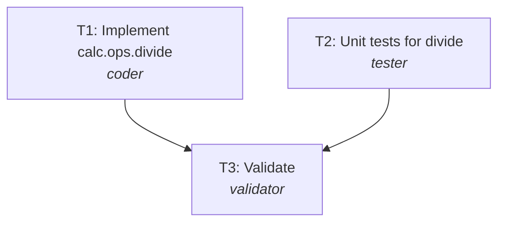

# Plan: REQ-404 Safe division helper

**Rationale:** One module and its tests, written in parallel from the spec, then validated.

**Change size:** patch (Small helper.)

## Tasks
| Task | Agent | Title | Depends on | Outputs |
|---|---|---|---|---|
| T1 | coder | Implement calc.ops.divide | - | calc/__init__.py, calc/ops.py |
| T2 | tester | Unit tests for divide | - | tests/test_ops.py |
| T3 | validator | Validate | T1, T2 | - |

## Execution order (tasks on one level run in parallel)
1. T1, T2 *(parallel)*
2. T3

## Risks
- None significant

## Trade-offs
- none
