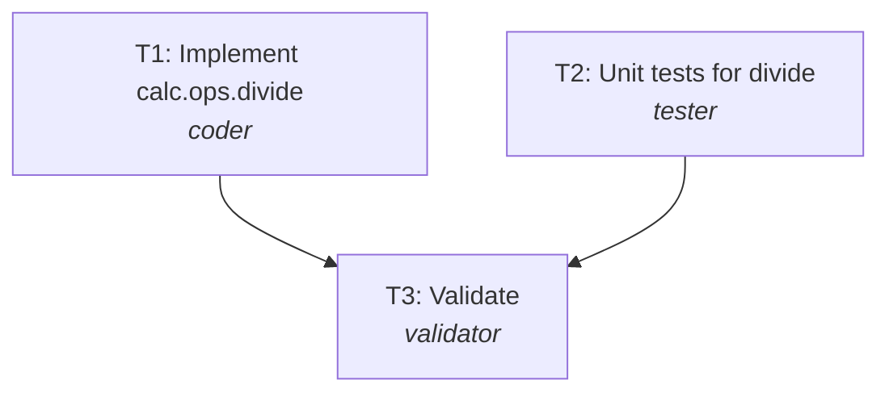

# Engineering summary: REQ-404 Safe division helper

| Field | Value |
|---|---|
| Run | `20261025-225249-ad5e2d` |
| Scenario | failing-calculator |
| Provider | mock |
| Phase | failed |
| Branch | `REQ-404-safe-division-helper` |
| Commit | - |
| LLM calls | 6 |

## 1. Requirement (normalized)
**Kind:** greenfield
**Intent:** Callers get a clear error instead of a crash or infinity when dividing by zero.

Provide calc.ops.divide(a, b) returning a / b, raising ValueError('cannot divide by zero') when b == 0.

**Acceptance criteria**
- AC1: divide(6, 3) == 2
- AC2: divide(x, 0) raises ValueError mentioning 'zero'

**Non-functional**
- none

**Out of scope**
- Other operations

## 2. Ambiguities and how they were resolved
None found.

## 3. Implementation plan and rationale
**Rationale:** One module and its tests, written in parallel from the spec, then validated.

**Change size:** patch (Small helper.)

### Tasks
| Task | Agent | Title | Depends on | Outputs |
|---|---|---|---|---|
| T1 | coder | Implement calc.ops.divide | - | calc/__init__.py, calc/ops.py |
| T2 | tester | Unit tests for divide | - | tests/test_ops.py |
| T3 | validator | Validate | T1, T2 | - |

### Execution order (tasks on one level run in parallel)
1. T1, T2 *(parallel)*
2. T3

## 4. Orchestration timeline
| Task | Agent | Attempt | Start | Duration | Overlapped with | Why |
|---|---|---|---|---|---|---|
| T1 | coder | 1 | +0.00s | 0.03s | T2 |  |
| T2 | tester | 1 | +0.01s | 0.03s | T1 |  |
| T3 | validator | 1 | +0.04s | 4.66s | - |  |
| T1 | coder | 2 | +4.72s | 0.02s | - | re-run with validation feedback |
| T3 | validator | 2 | +4.75s | 3.64s | - | re-validation |
| T1 | coder | 3 | +8.40s | 0.02s | - | re-run with validation feedback |
| T3 | validator | 3 | +8.42s | 3.54s | - | re-validation |

*Durations are short with the offline provider (no model latency); with a live model each agent step takes seconds to minutes and the parallel levels save that time.*

**Recovery events**
- routing failure to T1 for a fix
- routing failure to T1 for a fix
- T3 failed: validation failed; escalation rejected

## 5. Generated artifacts
| File | Produced by |
|---|---|
| `calc/__init__.py` | T1 |
| `calc/ops.py` | T1 |
| `tests/test_ops.py` | T2 |

## 6. Validation
| Check | Result | Summary |
|---|---|---|
| syntax | ✅ Passed | all Python files compile |
| lint | ✅ Passed | ruff: no issues |
| unsafe-code | ✅ Passed | no unsafe patterns |
| security | ✅ Passed | bandit: no medium/high issues |
| dependencies | ⏭️ Skipped | set SDLC_DEPENDENCY_AUDIT=1 to audit |
| contract | ⏭️ Skipped | no API contract declared |
| tests | ❌ Failed | no summary line |
| secrets | ✅ Passed | no secrets found |

## 7. Risks and trade-offs
**Risks**
- None significant

**Trade-offs**
- none

## 8. Human oversight (gate audit log)
| Gate | Decision | By | When | Note |
|---|---|---|---|---|
| plan | approved | policy:approve | 2026-10-25 22:53:09 |  |
| escalation | rejected | policy:reject | 2026-10-25 22:53:21 |  |

Approvals here were given by the written gate policy (`--policy auto`, used for this unattended run). Interactively, a human answers each gate; blockers are never auto-approved.

## 9. Assumptions and limitations
- Generated code is validated by tests, lint, an unsafe-pattern scan, a contract check and a secret scan; it is not load tested here. Scalability claims are design-level.
- With the mock provider the agents' answers are pre-written fixtures, not live model output; the orchestration, gates, git operations and all validation run for real.
