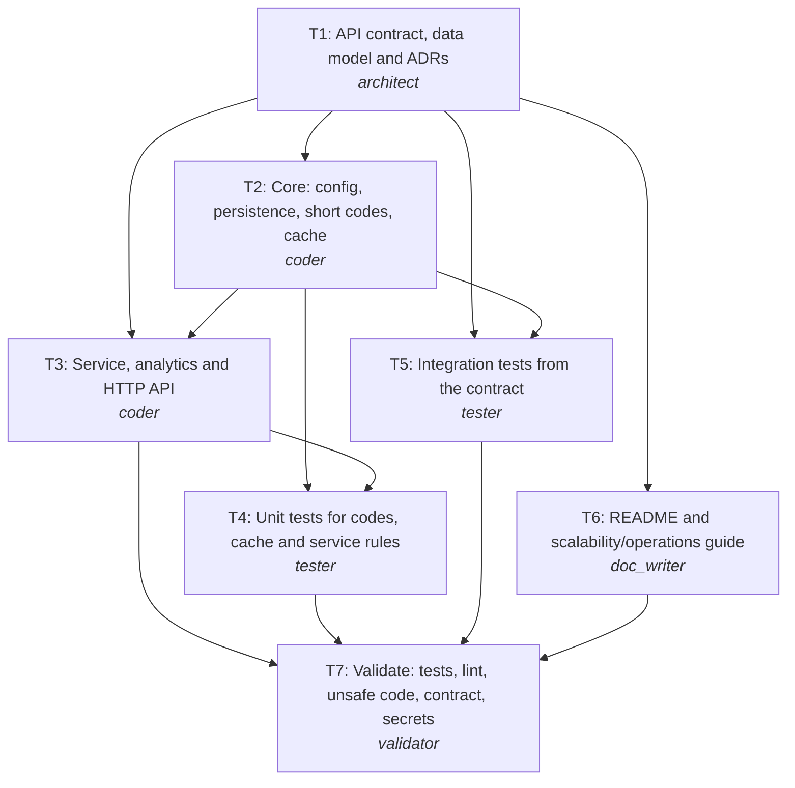

# Plan: REQ-101 URL shortener service

**Rationale:** Contract first: the architect fixes the API and data model (T1) so code, tests and docs can proceed in parallel against the same source of truth. Core infrastructure (config, persistence, codes, cache) is separated from the service/API layer so the integration tests (T5) can be written from the contract while the API is being implemented (T3), and the docs (T6) only need the contract. Unit tests for the service (T4) need its interface, so they follow T3. A single validator (T7) runs every check and routes failures back to the owning task.

**Change size:** minor (New service; nothing existing can break.)

## Tasks
| Task | Agent | Title | Depends on | Outputs |
|---|---|---|---|---|
| T1 | architect | API contract, data model and ADRs | - | api/openapi.yaml, db/schema.sql, docs/adr/0001-short-code-generation.md, docs/adr/0002-redirects-caching-and-analytics.md |
| T2 | coder | Core: config, persistence, short codes, cache | T1 | pyproject.toml, app/__init__.py, app/config.py, app/db.py, app/models.py, app/shortcode.py, app/cache.py |
| T6 | doc_writer | README and scalability/operations guide | T1 | README.md, docs/scalability.md |
| T3 | coder | Service, analytics and HTTP API | T1, T2 | app/schemas.py, app/repository.py, app/service.py, app/analytics.py, app/api.py, app/main.py |
| T5 | tester | Integration tests from the contract | T1, T2 | tests/conftest.py, tests/helpers.py, tests/integration/test_links_api.py, tests/integration/test_redirect_analytics.py |
| T4 | tester | Unit tests for codes, cache and service rules | T2, T3 | tests/unit/test_shortcode.py, tests/unit/test_cache.py, tests/unit/test_service.py |
| T7 | validator | Validate: tests, lint, unsafe code, contract, secrets | T3, T4, T5, T6 | - |

## Execution order (tasks on one level run in parallel)
1. T1
2. T2, T6 *(parallel)*
3. T3, T5 *(parallel)*
4. T4
5. T7

## Risks
- Analytics query differences between SQLite (tests) and PostgreSQL (production) can hide bugs; the same ORM queries are used, and a PostgreSQL CI job is the follow-up.
- In-process cache on several instances serves a deleted link for up to CACHE_TTL_SECONDS on other instances until Redis is introduced.
- Clicks recorded in background tasks can be lost if an instance crashes mid-request; acceptable for v1, removed by the queue.
- No authentication: anyone with network access to the API can delete links (internal API behind the gateway).

## Trade-offs
- Random codes over counter+base62: unguessable and coordination-free, at the cost of rare collision retries.
- 307 + no-store over 301: every click reaches us (accurate analytics, deletes take effect) at the cost of more traffic.
- Denormalized click_count for O(1) totals plus raw events for detail, instead of aggregating on every read.
- Background-task analytics now, queue + rollups later: simple to operate today, clear upgrade path.
