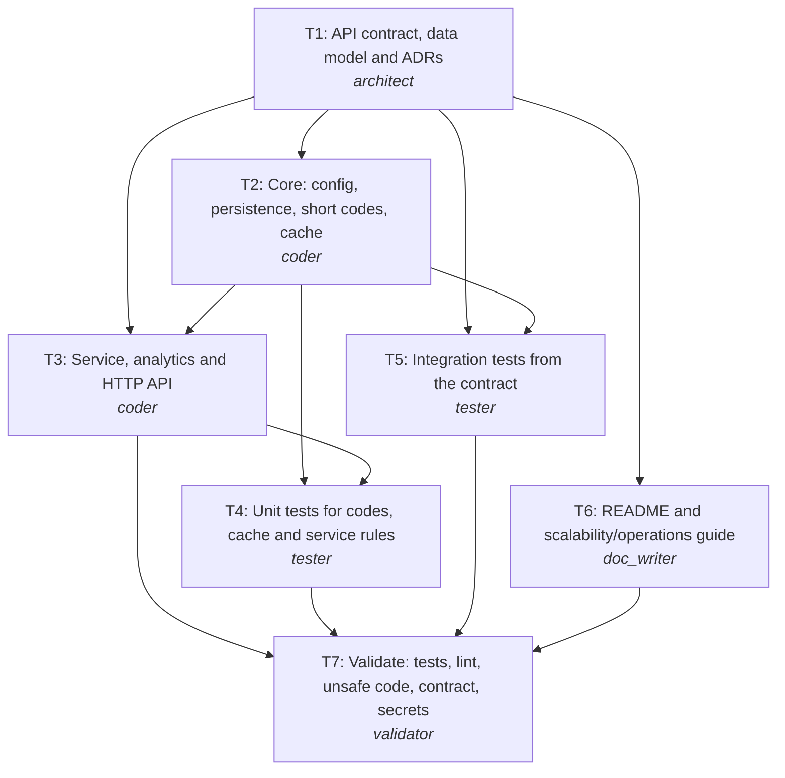

# Engineering summary: REQ-101 URL shortener service

| Field | Value |
|---|---|
| Run | `20261025-224922-736a4c` |
| Scenario | url-shortener |
| Provider | mock |
| Phase | reviewed |
| Branch | `REQ-101-url-shortener-service` |
| Commit | `828eaa3034` |
| LLM calls | 10 |

## 1. Requirement (normalized)
**Kind:** greenfield
**Intent:** Let users turn long URLs into short links that redirect reliably and show how often and from where they are used.

Build an HTTP service that creates short codes for long URLs, redirects short codes to their targets with low latency, persists links durably, and records click analytics (counts over time and referrers). The design must scale horizontally for a read-heavy workload, and the code must be structured so the cache and analytics pipeline can be swapped for distributed versions without changing the API.

**Acceptance criteria**
- AC1: POST /api/v1/links creates a short link for an http(s) URL and returns 201 with code and short_url; invalid URLs return 422.
- AC2: Optional custom alias: used as the code if valid and free; 409 if already taken; reserved words rejected with 422.
- AC3: Optional expiry: GET /{code} returns 410 after expires_at; expiry in the past is rejected at creation.
- AC4: GET /{code} returns 307 to the target URL; unknown or deleted codes return 404.
- AC5: Every redirect is recorded (timestamp, referrer, user agent) without adding latency to the redirect.
- AC6: GET /api/v1/links/{code}/stats returns total clicks, last click, daily counts and top referrers.
- AC7: GET and DELETE /api/v1/links/{code} return metadata and deactivate a link.
- AC8: Links and clicks persist in a relational database (PostgreSQL in production, SQLite locally).
- AC9: The API is described by an OpenAPI contract that the implementation matches exactly.

**Non-functional**
- Read-heavy: design for ~10k redirects/s at ~100:1 read/write; app tier stateless and horizontally scalable.
- Redirect p95 under 50 ms at the service (cache hit) excluding network.
- Codes must not be guessable/enumerable.
- Analytics failures must never break redirects.
- Configuration through environment variables; no secrets in code.

**Out of scope**
- User accounts, authentication and per-user link ownership
- Rate limiting (expected at the API gateway)
- Malicious URL screening, custom domains, link editing

## 2. Ambiguities and how they were resolved
| Id | Severity | Question | Resolution |
|---|---|---|---|
| Q1 | minor | Should the same long URL always return the same short code? | No: every create returns a new code. |
| Q2 | minor | 301 (permanent) or 302/307 (temporary) redirects? | 307 with Cache-Control: no-store, so analytics stay accurate. |
| Q3 | minor | How much analytics detail and how long is it kept? | Raw events with daily aggregation over the last 30 days; monthly partitions and retention at scale. |
| Q4 | minor | Who may delete links without authentication? | Auth is out of scope for v1; the API is internal behind the gateway. |

**Assumptions**
- Q1: No: every create returns a new code.
- Q2: 307 with Cache-Control: no-store, so analytics stay accurate.
- Q3: Raw events with daily aggregation over the last 30 days; monthly partitions and retention at scale.
- Q4: Auth is out of scope for v1; the API is internal behind the gateway.

## 3. Implementation plan and rationale
**Rationale:** Contract first: the architect fixes the API and data model (T1) so code, tests and docs can proceed in parallel against the same source of truth. Core infrastructure (config, persistence, codes, cache) is separated from the service/API layer so the integration tests (T5) can be written from the contract while the API is being implemented (T3), and the docs (T6) only need the contract. Unit tests for the service (T4) need its interface, so they follow T3. A single validator (T7) runs every check and routes failures back to the owning task.

**Change size:** minor (New service; nothing existing can break.)

### Tasks
| Task | Agent | Title | Depends on | Outputs |
|---|---|---|---|---|
| T1 | architect | API contract, data model and ADRs | - | api/openapi.yaml, db/schema.sql, docs/adr/0001-short-code-generation.md, docs/adr/0002-redirects-caching-and-analytics.md |
| T2 | coder | Core: config, persistence, short codes, cache | T1 | pyproject.toml, app/__init__.py, app/config.py, app/db.py, app/models.py, app/shortcode.py, app/cache.py |
| T6 | doc_writer | README and scalability/operations guide | T1 | README.md, docs/scalability.md |
| T3 | coder | Service, analytics and HTTP API | T1, T2 | app/schemas.py, app/repository.py, app/service.py, app/analytics.py, app/api.py, app/main.py |
| T5 | tester | Integration tests from the contract | T1, T2 | tests/conftest.py, tests/helpers.py, tests/integration/test_links_api.py, tests/integration/test_redirect_analytics.py |
| T4 | tester | Unit tests for codes, cache and service rules | T2, T3 | tests/unit/test_shortcode.py, tests/unit/test_cache.py, tests/unit/test_service.py |
| T7 | validator | Validate: tests, lint, unsafe code, contract, secrets | T3, T4, T5, T6 | - |

### Execution order (tasks on one level run in parallel)
1. T1
2. T2, T6 *(parallel)*
3. T3, T5 *(parallel)*
4. T4
5. T7

## 4. Orchestration timeline
| Task | Agent | Attempt | Start | Duration | Overlapped with | Why |
|---|---|---|---|---|---|---|
| T1 | architect | 1 | +0.00s | 0.02s | - |  |
| T2 | coder | 1 | +0.02s | 0.07s | T6 |  |
| T6 | doc_writer | 1 | +0.02s | 0.03s | T2 |  |
| T3 | coder | 1 | +0.08s | 0.09s | T5 |  |
| T5 | tester | 1 | +0.08s | 0.07s | T3 |  |
| T4 | tester | 1 | +0.17s | 0.05s | - |  |
| T7 | validator | 1 | +0.22s | 12.42s | - |  |
| T3 | coder | 2 | +12.66s | 0.07s | - | re-run with validation feedback |
| T7 | validator | 2 | +12.73s | 10.87s | - | re-validation |

*Durations are short with the offline provider (no model latency); with a live model each agent step takes seconds to minutes and the parallel levels save that time.*

**Recovery events**
- routing failure to T3 for a fix

## 5. Generated artifacts
| File | Produced by |
|---|---|
| `README.md` | T6 |
| `api/openapi.yaml` | T1 |
| `app/__init__.py` | T2 |
| `app/analytics.py` | T3 |
| `app/api.py` | T3 |
| `app/cache.py` | T2 |
| `app/config.py` | T2 |
| `app/db.py` | T2 |
| `app/main.py` | T3 |
| `app/models.py` | T2 |
| `app/repository.py` | T3 |
| `app/schemas.py` | T3 |
| `app/service.py` | T3 |
| `app/shortcode.py` | T2 |
| `db/schema.sql` | T1 |
| `docs/adr/0001-short-code-generation.md` | T1 |
| `docs/adr/0002-redirects-caching-and-analytics.md` | T1 |
| `docs/scalability.md` | T6 |
| `pyproject.toml` | T2 |
| `tests/conftest.py` | T5 |
| `tests/helpers.py` | T5 |
| `tests/integration/test_cache_invalidation.py` | review |
| `tests/integration/test_links_api.py` | T5 |
| `tests/integration/test_redirect_analytics.py` | T5 |
| `tests/unit/test_cache.py` | T4 |
| `tests/unit/test_service.py` | T4 |
| `tests/unit/test_shortcode.py` | T4 |

## 6. Validation
| Check | Result | Summary |
|---|---|---|
| syntax | ✅ Passed | all Python files compile |
| lint | ✅ Passed | ruff: no issues |
| unsafe-code | ✅ Passed | no unsafe patterns |
| security | ✅ Passed | bandit: no medium/high issues |
| dependencies | ⏭️ Skipped | set SDLC_DEPENDENCY_AUDIT=1 to audit |
| contract | ✅ Passed | 6 operations match api/openapi.yaml |
| tests | ✅ Passed | 44 passed |
| secrets | ✅ Passed | no secrets found |

## 7. Review
**Verdict:** approve_with_comments. Clean layering (api -> service -> repository), contract-first, and every acceptance criterion has tests. One missed scenario is fixed below (cached redirect after delete); two follow-ups are recorded for the next iteration.

- [medium] missed scenario: Delete invalidates the cache, but no HTTP-level test proves a link that was already redirected (so cached) stops redirecting after delete.
- [low] missed scenario: POST /api/v1/links has no rate limit; scripted abuse can fill the table.
- [low] patterns: Stats aggregate raw click_events on every request; fine at v1 volume but O(clicks) per call.

## 8. Risks and trade-offs
**Risks**
- Analytics query differences between SQLite (tests) and PostgreSQL (production) can hide bugs; the same ORM queries are used, and a PostgreSQL CI job is the follow-up.
- In-process cache on several instances serves a deleted link for up to CACHE_TTL_SECONDS on other instances until Redis is introduced.
- Clicks recorded in background tasks can be lost if an instance crashes mid-request; acceptable for v1, removed by the queue.
- No authentication: anyone with network access to the API can delete links (internal API behind the gateway).

**Trade-offs**
- Random codes over counter+base62: unguessable and coordination-free, at the cost of rare collision retries.
- 307 + no-store over 301: every click reaches us (accurate analytics, deletes take effect) at the cost of more traffic.
- Denormalized click_count for O(1) totals plus raw events for detail, instead of aggregating on every read.
- Background-task analytics now, queue + rollups later: simple to operate today, clear upgrade path.

## 9. Human oversight (gate audit log)
| Gate | Decision | By | When | Note |
|---|---|---|---|---|
| plan | approved | policy:approve | 2026-10-25 22:49:38 |  |
| commit | approved | policy:approve | 2026-10-25 22:50:02 |  |
| pr | approved | policy:approve | 2026-10-25 22:50:20 |  |
| review_fixes | approved | policy:approve | 2026-10-25 22:50:23 |  |

Approvals here were given by the written gate policy (`--policy auto`, used for this unattended run). Interactively, a human answers each gate; blockers are never auto-approved.

## 10. Assumptions and limitations
- Q1: No: every create returns a new code.
- Q2: 307 with Cache-Control: no-store, so analytics stay accurate.
- Q3: Raw events with daily aggregation over the last 30 days; monthly partitions and retention at scale.
- Q4: Auth is out of scope for v1; the API is internal behind the gateway.
- Generated code is validated by tests, lint, an unsafe-pattern scan, a contract check and a secret scan; it is not load tested here. Scalability claims are design-level.
- With the mock provider the agents' answers are pre-written fixtures, not live model output; the orchestration, gates, git operations and all validation run for real.
